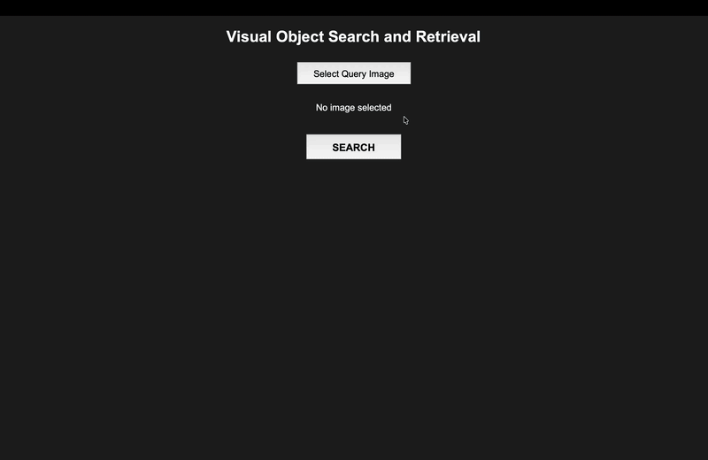
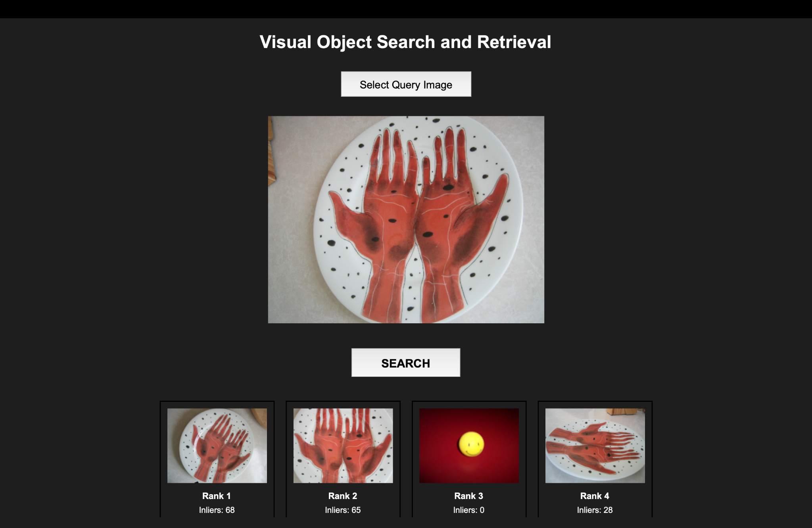

# Visual Object Search and Retrieval

Search a photo collection with a query image using classical computer vision. This Foundations of Computer Vision mini-project indexes the **10,200-image UKBench** dataset with SIFT and returns visually related objects through a Tkinter desktop app.






## How it works

1. **Index once:** Extract SIFT keypoints and descriptors; sample 100,000 descriptors to train a **4,000-word** K-means vocabulary; build L2-normalized TF-IDF vectors for every image.
2. **Shortlist:** Encode the query with the same vocabulary and scan the stored vectors by cosine similarity, retaining the best **600** candidates.
3. **Verify and rank:** For each candidate, apply brute-force SIFT KNN matching, Lowe's ratio test (**0.8**), and RANSAC homography (**5 px**). A weighted score combines normalized TF-IDF similarity, good matches, and geometric inliers (weights **0.25 / 0.70 / 0.05**, with `log1p` on the latter two).

The app displays the top four matches. A [separate CLIP follow-up](https://github.com/ironprathamx/deep-visual-search) explores semantic retrieval.

## Results

The [recorded full evaluation](results/full_eval_2.txt) uses the first image from each of **2,550** UKBench groups as a query against all **10,200** images, with **zero failed queries**.

| Metric | Result |
|---|---:|
| UKBench N-S, top 4 | **3.1553 / 4** (78.88%) |
| Recall@4 / Recall@10 | **73.88% / 78.72%** |
| Hit@1 / Hit@10 | **86.47% / 92.90%** |
| Mean reciprocal rank | **0.8872** |
| Mean time per query | **14.25 s** |

N-S counts the query itself if it appears in the top four. Recall and hit rates exclude the query and treat the other **three** images in its group as relevant; thus Recall@1 and Hit@1 have different denominators. The recorded run took **605.5 minutes** overall on a MacBook M2 Air.

The engineering challenge was uneven feature density (**5 to 13,276 SIFT keypoints per image**) and a feature cache exceeding **7 GB**. An early exhaustive SIFT query took **537.9 s** ([original run](output/init/initial.png)); BoVW/TF-IDF reduced the expensive verification set. These prototype and final timings come from different runs, so they are illustrative rather than a controlled speed comparison.

## Run locally

Python 3, a desktop environment with Tkinter, and the [UKBench JPEGs](https://archive.org/details/ukbench) are required. The dataset and generated feature/index files are not bundled. Place images directly at `dataset/ukbench/ukbench00000.jpg`, `...00001.jpg`, etc. Allow several GB of free disk space and RAM for the feature cache.

```bash
git clone https://github.com/ironprathamx/visual-object-search-retrieval.git
cd visual-object-search-retrieval
python3 -m venv .venv
source .venv/bin/activate  # Windows: .venv\Scripts\activate
pip install -r requirements.txt

# After placing all 10,200 JPEGs in dataset/ukbench/:
python src/precompute_features.py
python src/sample_sift_descriptors.py
python src/build_visual_vocabulary.py
python src/build_tfidf_index.py

python src/gui/app.py
```

The four indexing commands must run in order; their outputs go to `results/`. The GUI loads those files at startup. On Linux, install your distribution's `python3-tk` package if Tkinter is missing. The first indexing pass and a full evaluation can take hours on a laptop.

To reproduce the group-level evaluation after indexing, run `python src/final_eval.py`. It saves a local summary under `results/`; the checked-in [`full_eval_2.txt`](results/full_eval_2.txt) is the recorded result. `src/experiments/` contains the earlier exhaustive matcher and other retrieval experiments.

## Contributors

- **Pratham Joshi:** backend, search engine, indexing and evaluation pipeline.
- **Mehran P. S. Dhakray:** Tkinter GUI and work on the later CLIP/CNN extension.
